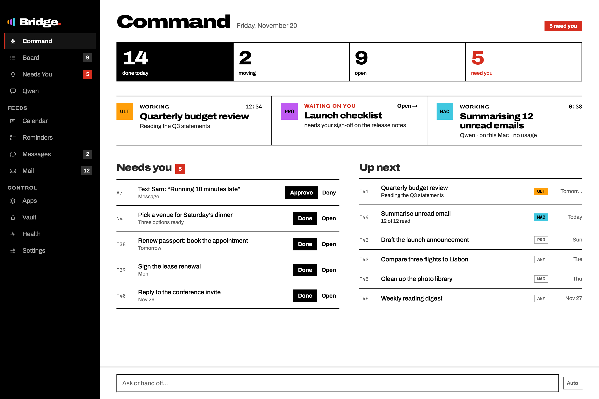
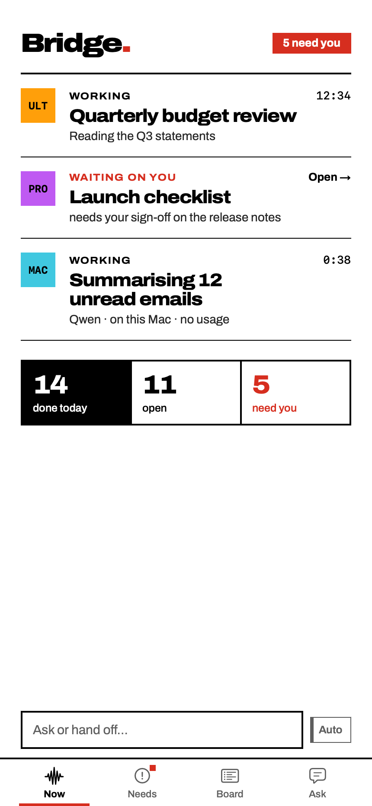
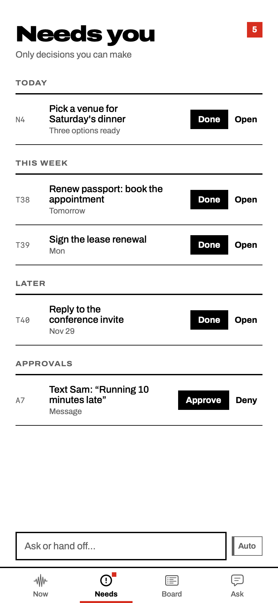
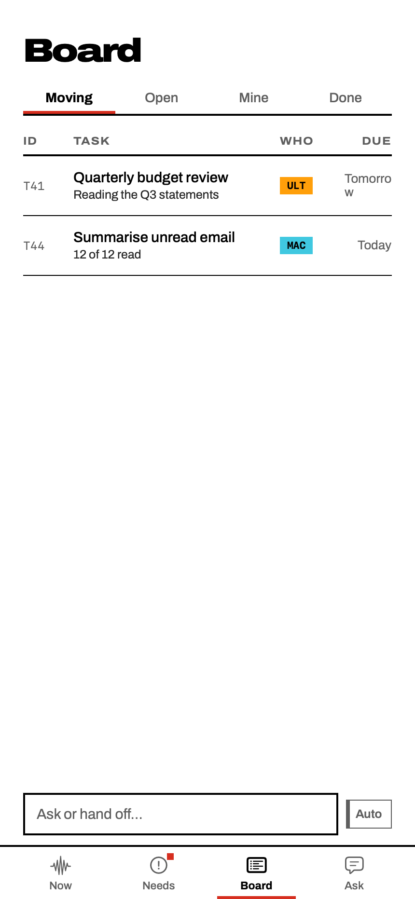
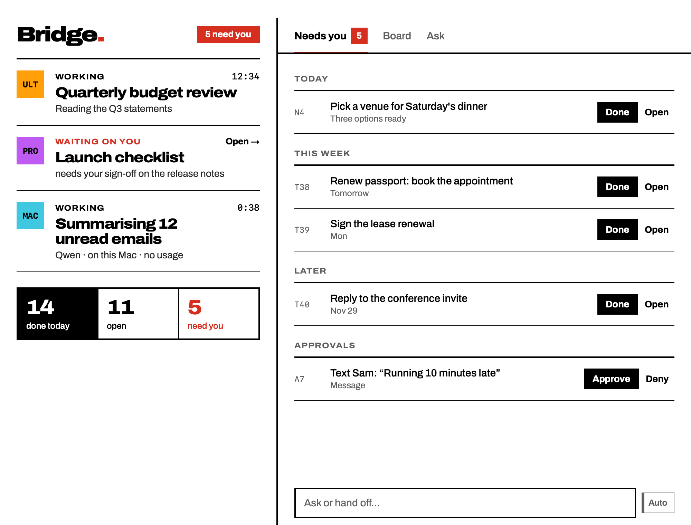

# Bridge.

**One board for two Claude accounts and a local model, on a Mac and a foldable iPhone.**

Bridge watches three AI "runners" that share one task board: two Claude accounts (**ULT**, **PRO**) and Qwen running locally on the Mac (**MAC**). It shows what each one is doing right now, what only you can decide, and lets you hand off work in one line. Qwen goes first, so simple jobs cost no Claude usage. Claude takes over only when a job needs the web, code or judgment.



| Folded | Needs you | Board | Unfolded |
|---|---|---|---|
|  |  |  |  |

*Screenshots are rendered from the real SwiftUI views with invented demo data (`Tools/Shots.swift`).*

## What it does

- **Now.** Each runner gets a lane showing the chat it's in, the step it's on and a live timer. A runner that is waiting on you turns red and names the chat that is waiting.
- **Needs you.** Tasks only you can do, decisions the runners raised, and actions that wait for your OK (a message to send, a login to fill). Done, Approve and Deny apply instantly and roll back if the engine refuses.
- **Board.** Tabs for what's moving, open, yours and done, with a fixed ID column, who each task is for, and when it's due.
- **Ask.** Type a request and Bridge routes it: to Qwen when local is enough, to a Claude account when it isn't. It says why, and one tap sends it to Ultra instead.
- **Two sizes, one layout system.** Folded, it's one screen at a time with tabs. Unfolded (720 pt and wider), Now stays on the left and everything else sits on the right.

## How it fits together

```
Bridge engine (Python, not in this repo)  →  snapshot.json every second
        │                                        │
        │  bridge CLI  ←───────  Mac: Bridge.app (MacApp/) + BridgeKit (Kit/)
        │
        └─ relay (Relay/bridge_relay.py)  ⇄  iCloud Drive: live/companion.json, live/requests, live/results
                                                  │
                                         iPhone: Apps/Phone + BridgeKit
```

- **`Kit/`, BridgeKit.** The shared SwiftUI module: style, data, and the Now, Needs, Board and Ask screens. The Mac backend watches the engine's snapshot through a file-system watcher and acts through the `bridge` CLI. The iPhone backend reads the relay's copy in iCloud Drive and drops request files.
- **`MacApp/`, Bridge.app.** Sidebar, feeds (Calendar, Reminders, Messages, Mail, Notes), app control, a Keychain-backed vault, the notch Live Activity, and a compact window (⌘⇧K, `bridge://compact`). Command, Board and Needs You are BridgeKit views.
- **`Apps/Phone`.** The iPhone app. On first launch, pick the `claude-bridge` folder in iCloud Drive.
- **`Relay/`.** Publishes a slim board for the phone and runs its requests within about 0.1 s (kqueue, no polling). It only accepts `done`, `resolve`, `approve`, `deny`, `assign`, `ask` and `route`, always as the owner and never through a shell.

The engine itself (task store, routing, feeds, vault and Qwen worker) is not included. The apps expect `~/Library/Application Support/Bridge/snapshot.json` and a `bridge` command on the PATH.

## Design

The "Swiss Tombstone" system from [bollineni.co](https://bollineni.co): a white page, black type and one red (`#D62E1F`). Names and figures are set in [Archivo](https://fonts.google.com/specimen/Archivo), wide and heavy. Corners are square, with 2px black rules and figures in joined tombstone boxes. The only other colour belongs to the runners, and only while they work. The Mac sidebar is the one dark "night room".

## Build

Requires Xcode 26+ and [XcodeGen](https://github.com/yonaskolb/XcodeGen).

```sh
xcodegen generate                        # iPhone app + BridgeKit (project.yml)
open BridgeCompanion.xcodeproj           # scheme BridgePhone; set your team in project.yml
cd MacApp && xcodegen generate && open Bridge.xcodeproj
swiftc -parse-as-library -o shots Kit/Shared/*.swift Kit/Mac/*.swift Tools/Shots.swift && ./shots Kit/Fonts/Archivo.ttf docs/screens
```

## License

MIT for the code (see `LICENSE`). Archivo is under the SIL Open Font License (`Kit/Fonts/OFL.txt`).
